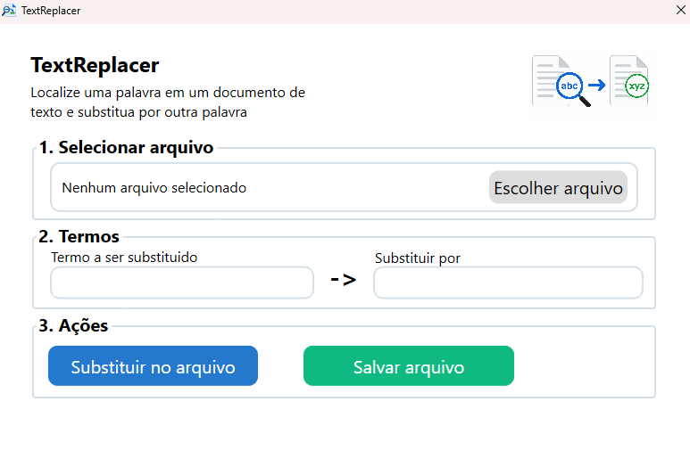
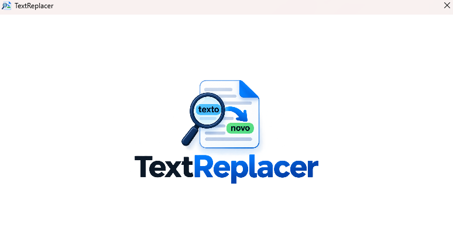

# TextReplacer

Aplicação desktop simples para substituição automatizada de termos em documentos.

Desenvolvida em **C#**, **WPF** e **.NET 10** durante meu estágio na **Prefeitura Municipal de Sales Oliveira**.

## 📌 Sobre o projeto

O **TextReplacer** é uma aplicação desenvolvida para automatizar uma tarefa repetitiva realizada durante o estágio.

A ferramenta permite que o usuário selecione um documento e realize a substituição de termos específicos, evitando a necessidade de localizar e alterar cada ocorrência manualmente.

O projeto foi desenvolvido com foco em **simplicidade e objetividade**, possuindo apenas as funcionalidades necessárias para resolver o problema identificado.

Não utiliza banco de dados, sistema de login ou outras funcionalidades desnecessárias para sua finalidade.

> **Nota:** O projeto foi desenvolvido durante meu estágio na Prefeitura Municipal de Sales Oliveira, com autorização para utilização como parte do meu portfólio. O repositório não contém documentos, dados pessoais ou informações internas da Prefeitura.

## 🎯 Objetivo

Facilitar e agilizar a alteração de termos específicos em documentos, reduzindo o trabalho manual e tornando o processo menos suscetível a erros.

## ✨ Funcionalidades

- Seleção de documentos;
- Localização de termos específicos;
- Substituição automática de termos;
- Possibilidade de realizar múltiplas substituições antes de salvar;
- Botões independentes para substituir e salvar o documento;
- Alerta quando o termo informado não é encontrado no documento;
- Salvamento com o nome original acrescido do sufixo `_corrigido`;
- Interface gráfica simples e direta;
- Publicação para Windows x64.

## 🆕 Atualizações da versão 1.1.0

- **Separação de operações:** independência entre as funcionalidades de substituição e salvamento;
- **Múltiplas substituições:** possibilidade de realizar diversas substituições antes de salvar o documento;
- **Salvamento aprimorado:** geração de um nome automático utilizando o nome original acrescido de `_corrigido`;
- **Validação de termos:** exibição de um alerta quando o termo informado não é encontrado no documento;
- **Identidade visual:** implementação de um ícone personalizado para o aplicativo, com resolução adequada;
- **Organização do projeto:** reestruturação dos diretórios, com criação das pastas `Views` e `Assets`, incluindo a separação de ícones e imagens.

## 📁 Estrutura do projeto

```text
TextReplacer/
│
├── Assets/
│   ├── Icons/
│   └── Images/
│
├── Views/
│
├── Services/
│
├── Properties/
│   └── PublishProfiles/
│
├── docs/
│   ├── tela-principal.png
│   └── tela-inicializacao.png
│
├── App.xaml
├── App.xaml.cs
├── AssemblyInfo.cs
├── TextReplacer.csproj
├── TextReplacer.slnx
├── .gitignore
├── LICENSE
└── README.md
```

### Organização dos diretórios

- **Assets:** reúne os recursos estáticos utilizados pelo aplicativo.
  - `Icons`: ícones do aplicativo.
  - `Images`: imagens utilizadas na interface.
- **Views:** reúne as telas e seus respectivos arquivos XAML.
- **Services:** concentra os serviços responsáveis por operações específicas da aplicação.
- **Properties:** contém configurações e propriedades do projeto.
- **docs:** armazena imagens utilizadas na documentação do repositório.

## 🖥️ Interface

### Tela principal



### Tela de inicialização



## ⚙️ Tecnologias utilizadas

- C#
- WPF (Windows Presentation Foundation)
- .NET 10

## 🖥️ Como funciona

O funcionamento da aplicação é simples:

```text
Selecionar documento
        ↓
Informar termo a ser substituído
        ↓
Informar novo termo
        ↓
Realizar substituição
        ↓
Repetir o processo, se necessário
        ↓
Salvar documento
        ↓
Documento corrigido
```

O documento resultante é salvo utilizando o nome original acrescido de `_corrigido`.

**Exemplo:**

`documento.txt` → `documento_corrigido.txt`